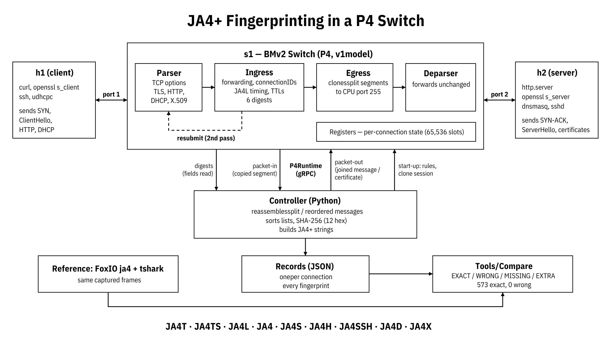

# JA4+ fingerprinting in a P4 switch

This project computes [JA4+](https://github.com/FoxIO-LLC/ja4) network fingerprints for the traffic passing through a
P4 switch, and gets the same values as FoxIO's reference `ja4` tool on the same packets. The switch is BMv2
(`simple_switch_grpc`, P4-16, v1model). A small Python controller talks to it over P4Runtime. Every packet is
forwarded byte for byte unchanged.



The work is split between the switch and the controller:

* **Switch (P4):** forwards h1 <-> h2. It also reads every fingerprint field itself: TCP window, options, MSS,
  window scale, TTL and timestamps, plus the fields of the TLS ClientHello/ServerHello, the HTTP request headers,
  DHCP/DHCPv6 options, X.509 certificate OIDs and SSH packet sizes. It sends them up as digests.
* **Controller (Python):** joins messages that were split across TCP segments or arrived out of order, sorts lists,
  hashes (SHA-256, first 12 hex digits) and writes the JA4+ strings. It never reads a fingerprint field from packet
  bytes itself.

## Fingerprints

| Name | Taken from |
|---|---|
| JA4T / JA4TS | client SYN / server SYN-ACK |
| JA4L (-C, -S) | handshake timing and TTL, measured in the switch |
| JA4 | TLS ClientHello (also when split or reordered) |
| JA4S | TLS ServerHello |
| JA4X | X.509 certificates (TLS 1.2, where they are sent in the clear) |
| JA4H | HTTP/1.x request headers (also when split, and on keep-alive connections) |
| JA4SSH | SSH packet sizes and directions |
| JA4D / JA4D6 | DHCP / DHCPv6 messages |

Not covered: HTTP/2 and HTTP/3, TLS 1.3 certificates and QUIC. All of these are encrypted, and a switch cannot
decrypt them. Tunnels (GRE, VXLAN, Geneve) are also out of scope.

## Results

| Run | Result |
|---|---|
| Replay of FoxIO's 33 sample captures (`make compare`) | 573 exact, 5 explained, **0 wrong / missing / extra**; 9,013 / 9,013 frames forwarded unchanged |
| Live Mininet run, real clients and servers (`make live`) | **47 / 47 exact**; 95 / 95 and 85 / 85 frames unchanged; JA4L within a median 23 µs of the reference |
| Split / reorder tests | 202 / 202 split and reorder cases, 19 / 19 server-flight orders, 18 / 18 keep-alive orders |

If a message never completes, the project reports it as missing and never makes up a value.

## Repository layout

```
p4/            P4 program: main.p4, parsers (TLS, HTTP, DHCP, X.509) and one control per fingerprint
controller/    P4Runtime client, reassembly of split messages, JA4+ formatters, per-connection records
tools/         replay through the real switch, comparison with FoxIO's tool, field-count measurement
network/       live Mininet topology h1 -- s1 -- h2 (run_live.py)
tests/         unit tests: split/reorder, port reuse, VLAN, capacity limits, digest corner cases
docs/          design and detailed-architecture write-ups (LaTeX + PDF)
results/       output of the comparison, live and measurement runs
build/         compiled program (main.json, main.p4info.txtpb), created by `make build`
```

## Requirements

Tested on Ubuntu 24.04:

* [p4c](https://github.com/p4lang/p4c) (tested 1.2.5) and [BMv2](https://github.com/p4lang/behavioral-model)
  `simple_switch_grpc` (tested 1.15), including libnanomsg
* Python 3.12 with `grpcio`, `protobuf`, `p4runtime` and `scapy`. The
  [p4-guide](https://github.com/jafingerhut/p4-guide) install scripts set up all of this in a virtualenv.
* FoxIO's [ja4](https://github.com/FoxIO-LLC/ja4) repository, cloned to `~/ja4`, with its Rust tool built
  (`~/ja4/rust/target/release/ja4`), and `tshark`. These provide the reference values and the sample captures in
  `~/ja4/pcap`.
* Only for `make live`: root, Mininet, `openssl`, `curl`, `dnsmasq`, `busybox` (for `udhcpc` / `udhcpc6`), and `sshd` for the SSH step
  (`sudo apt install openssh-server`; the system service can stay disabled, since the run starts its own sshd)

If FoxIO's repository is somewhere else, either link it to `~/ja4` or set `JA4_BIN` to the path of the `ja4` binary.

## Running

```bash
source ~/p4dev-python-venv/bin/activate        # or wherever the P4 Python packages live

make build      # compile p4/main.p4 -> build/main.json, build/main.p4info.txtpb
make test       # unit tests (~2 min, no root needed)
make compare    # replay FoxIO's sample captures through switch + controller, compare with FoxIO's tool
make docs       # build docs/design.pdf and docs/detailed_architecture.pdf

# live run in Mininet (root). If Mininet is installed for the system Python, add its path:
sudo mn -c
sudo env PATH="$PATH" PYTHONPATH="/usr/lib/python3/dist-packages" make live
```

Output files:

* `make compare`: a verdict per capture on stdout and `results/compare.json`
* `make live`: `results/live/report.txt` and `records.json`, plus pcaps from both switch ports
* `make live` also regenerates `docs/results_live.tex`

`tools.compare` and `tools.replay` also accept single captures:

```bash
python3 -m tools.compare ~/ja4/pcap/tls12.pcap
python3 -m tools.replay  ~/ja4/pcap/tls12.pcap
```

## Notes

* **Verdicts:** EXACT means the value matches the reference. EXPLAINED is a difference that was checked by hand and
  is documented in `docs/`. WRONG, MISSING and EXTRA fail the run, and so does any frame that is lost or altered.
* **Replay timing:** the replay uses the original time gaps between frames, capped at 2 s. On a busy machine, BMv2
  may drop frames during a dense burst (seen in `http2-with-cookies.pcapng`); those frames are lost, not altered.
  Run `make compare` on an otherwise idle machine.
* **tshark version:** `tests.test_vlan_and_ssh_port` expects tshark to recognise SSH on a non-standard port by its
  banner. Older tshark versions (e.g. 4.2.2) don't, so FoxIO's tool reports no JA4SSH there and the test reports
  the switch's (correct) value as EXTRA.

## Credits

JA4+ was designed by [FoxIO](https://github.com/FoxIO-LLC/ja4), and the sample captures used in `make compare` come
from their repository. See FoxIO's repository for the JA4+ licence terms. JA4 itself is BSD 3-Clause; the other JA4+
methods are under the FoxIO License 1.1.
